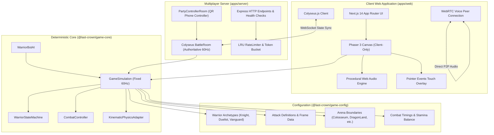

<div align="center">

# ⚔️ LAST CROWN

### _"Only One Shall Reign."_

An enterprise-grade, browser-based 2D medieval sword-fighting game featuring deterministic 60Hz physics, frame-perfect parrying, stamina management, WebRTC peer-to-peer voice chat, and server-authoritative multiplayer.

[](https://github.com/mujahidalmahi/last-crown/actions/workflows/ci.yml)
[](LICENSE)
[](https://www.typescriptlang.org/)
[](https://nextjs.org/)
[](https://phaser.io/)
[](https://colyseus.io/)
[](docs/testing/strategy.md)
[](https://prettier.io)

**[🌐 Live Play (Production)](https://last-crown.top)** • **[📖 Technical Documentation](docs/)** • **[🛡️ Security Policy](SECURITY.md)** • **[🤝 Contributing](CONTRIBUTING.md)**

</div>

---

## 🌟 Highlights & Key Features

- **⚡ Server-Authoritative 60Hz Netcode**: Built on Colyseus WebSocket rooms. The server executes a headless deterministic physics simulation, validates every input intent via Zod schemas, and eliminates client-side cheating.
- **🛡️ Deep Sword Combat Mechanics**:
  - **Frame-Perfect Parrying**: 180ms defensive window that staggers opponents for counter-punishes.
  - **Tactical Feinting**: Cancel attack windup into an immediate dash, parry, or block.
  - **Posture & Guard Breaks**: Depleting an opponent's stamina inflicts a 450ms guard break followed by exhaustion.
  - **Spatial Cross-Up Detection**: Relative coordinate calculations ensure cross-up strikes bypass shields.
- **🎙️ Low-Latency WebRTC Voice Chat**: Peer-to-peer spatial audio with Cloudflare TURN/STUN failover, background noise cancellation, and Colyseus signaling.
- **📱 Responsive Mobile & Companion Controller**:
  - Touch-optimized overlay using Pointer Events with tactile haptics (`navigator.vibrate`).
  - Automatic landscape mode enforcement (`100dvh` viewport).
  - Scan-to-play QR companion phone controller (`/controller`) turning any mobile device into a physical gamepad.
- **🎮 Local & Offline Play**:
  - **Offline Single-Player**: Fully client-side AI bot featuring reaction windows, distance zoning, and parry timing.
  - **Local 2-Player Split Keyboard / Dual Gamepad**: Play head-to-head on a single screen without an internet connection.
- **🎨 Authentic Retro Arcade Aesthetic**: Crisp pixel-art rendering (`pixelArt: true`, `roundPixels: true`), retro `'Press Start 2P'` typography, and synthesized procedural 8-bit Web Audio.

---

## 🏛️ System Architecture

LAST CROWN is organized as a high-performance TypeScript monorepo using npm workspaces:



### Monorepo Workspaces

| Workspace                     | Type        | Path                   | Purpose                                                                        |
| :---------------------------- | :---------- | :--------------------- | :----------------------------------------------------------------------------- |
| **`@last-crown/shared`**      | Package     | `packages/shared`      | Wire protocols, Zod validation schemas, domain types, Colyseus schemas         |
| **`@last-crown/game-config`** | Package     | `packages/game-config` | Balance parameters, attack frame data, arena bounds, warrior presets           |
| **`@last-crown/game-core`**   | Package     | `packages/game-core`   | Headless deterministic simulation engine, combat controller, state machine, AI |
| **`@last-crown/server`**      | Application | `apps/server`          | Authoritative Colyseus rooms, matchmaking registry, rate limiting              |
| **`@last-crown/web`**         | Application | `apps/web`             | Next.js 14 portal, Phaser 3 game scenes, mobile controls, WebRTC voice         |

---

## 🕹️ Controls & Input Mapping

### Desktop (Keyboard & Gamepad)

| Action                | Player 1 Keyboard        | Player 2 Keyboard | Gamepad (Standard XInput / DualShock)  |
| :-------------------- | :----------------------- | :---------------- | :------------------------------------- |
| **Move Left / Right** | `A` / `D`                | `←` / `→`         | D-Pad Left/Right or Left Stick         |
| **Jump**              | `W`                      | `↑`               | Button Bottom (`A` / `Cross`)          |
| **Light Slash**       | `J`                      | `Num 1`           | Button Left (`X` / `Square`)           |
| **Heavy Strike**      | `S` + `J`                | `↓` + `Num 1`     | Button Top (`Y` / `Triangle`)          |
| **Forward Thrust**    | `D` + `J` (Facing Right) | `→` + `Num 1`     | Button Right (`B` / `Circle`)          |
| **Block / Guard**     | `K` (Hold)               | `Num 2` (Hold)    | Left Shoulder / Trigger (`LB` / `L2`)  |
| **Parry**             | `L` (Tap)                | `Num 3` (Tap)     | Right Shoulder / Trigger (`RB` / `R2`) |
| **Tactical Dash**     | `Space`                  | `Num 0`           | Left Stick Click (`L3`) or Dash Button |

### Mobile Touch Controls

- **Left Side**: Directional D-Pad (Left, Right) + Jump Button + Tactical Dash Button.
- **Right Side**: Light Slash, Heavy Strike, Guard (Hold), and Parry (Tap).

---

## 🚀 Quickstart & Local Development

### Prerequisites

- **Node.js**: `>=20.0.0` (LTS recommended)
- **npm**: `>=10.0.0`

### 1. Clone & Install

```bash
git clone https://github.com/mujahidalmahi/last-crown.git
cd last-crown
npm install
```

### 2. Configure Environment

```bash
cp .env.example .env
```

### 3. Start Development Servers

```bash
npm run dev
```

- **Web Portal**: [http://localhost:3000](http://localhost:3000)
- **Multiplayer Server**: [http://localhost:2567](http://localhost:2567) (WebSocket: `ws://localhost:2567`)

---

## 🛠️ Monorepo CLI Commands

| Command                | Description                                                 |
| :--------------------- | :---------------------------------------------------------- |
| `npm run dev`          | Runs both web frontend and multiplayer server concurrently  |
| `npm run dev:web`      | Starts Next.js development server on port `3000`            |
| `npm run dev:server`   | Starts Colyseus development server on port `2567`           |
| `npm run build`        | Compiles shared packages, server, and static Next.js export |
| `npm run typecheck`    | Strict TypeScript compiler check across all 5 workspaces    |
| `npm run test`         | Executes all 103 unit and integration tests with Vitest     |
| `npm run test:e2e`     | Runs Playwright browser smoke tests                         |
| `npm run lint`         | Codebase-wide ESLint validation                             |
| `npm run format:check` | Prettier code style verification                            |
| `npm run format:write` | Automatically formats all source code and markdown files    |

---

## 📚 Technical Documentation Hub

Detailed documentation is maintained in the [`docs/`](docs/) directory:

- **Architecture & Loop**:
  - [System Architecture Overview](docs/architecture/overview.md)
  - [60Hz Deterministic Simulation Loop](docs/architecture/game-loop.md)
  - [Multiplayer Synchronization & WebRTC](docs/architecture/multiplayer.md)
  - [Network Protocol Specification](docs/architecture/protocol-specification.md)
- **Combat & Balance**:
  - [Combat System & Mechanics](docs/game-design/combat-system.md)
  - [Warrior Frame Data & Move Attributes](docs/game-design/frame-data.md)
- **Hardware & Mobile**:
  - [Mobile & Companion Controller Architecture](docs/mobile/mobile-architecture.md)
  - [Public Assets & Graphic Specifications](apps/web/public/README.md)
- **Operations & Security**:
  - [Threat Model & Anti-Cheat](docs/security/threat-model.md)
  - [Testing Strategy & Test Automation](docs/testing/strategy.md)
  - [Production Operations & Deployment Runbook](docs/deployment/production-operations.md)
  - [Free-Tier Deployment Guide](docs/deployment/free-tier.md)
- **Governance**:
  - [Architecture Decision Records (ADRs)](docs/decisions/)
  - [Production Readiness Audit](docs/audit/production-readiness-audit.md)

---

## 🛡️ Security

Security disclosures are handled privately and responsibly. See our [Security Policy](SECURITY.md) for supported versions, threat modeling, and contact information.

---

## 🤝 Contributing

We welcome contributions! Please read our [Contributing Guide](CONTRIBUTING.md) and [Code of Conduct](CODE_OF_CONDUCT.md) before opening a pull request.

---

## 📄 License

This project is licensed under the terms of the [MIT License](LICENSE).  
Copyright (c) 2026 LAST CROWN Contributors.
