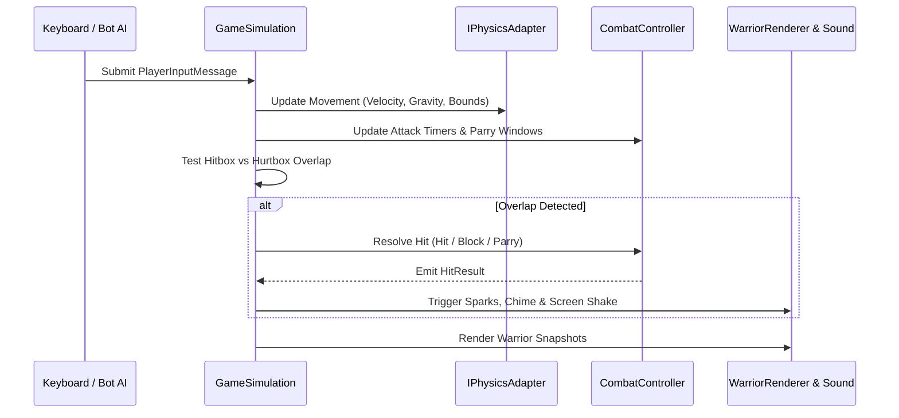

# Game Loop and Simulation Lifecycle

## 60 Hz Update Loop

`GameSimulation` executes on a fixed timestep of `16.666ms` (60 Hz):

## Combat Phases

Attacks are structured into three deterministic discrete phases:

1. **Wind-up Phase**: The warrior prepares their strike. Cannot attack or block during windup. Opponents have a visual tell to react with a block or parry.
2. **Active Phase**: The directional hitbox is energized. Collision against the opponent's hurtbox is checked. If the opponent is in active parry window, the strike is deflected and the attacker is stunned!
3. **Recovery Phase**: Hitbox is de-energized. The warrior recovers balance before returning to idle.
