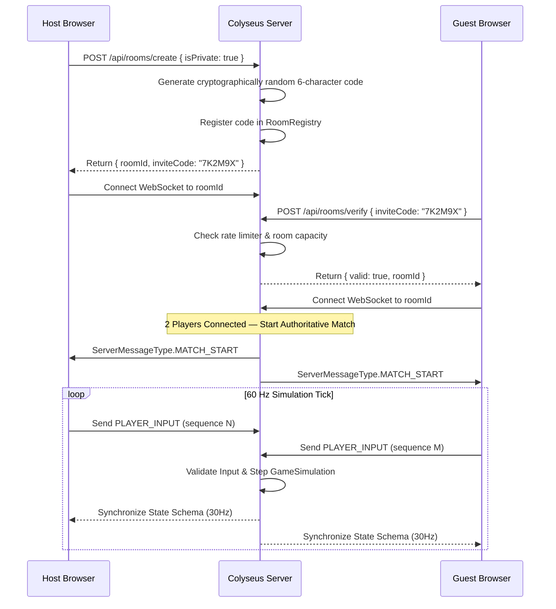

# Authoritative Multiplayer Architecture

## Private Two-Player Room Flow

## Security Safeguards

- **Strict Room Capacity**: Capped at exactly 2 clients (`maxClients = 2`). Third clients attempting to connect are rejected.
- **Input Sanitization**: Client messages are validated against `PlayerInputSchema` (Zod). Out-of-range floats, invalid directions, or negative sequences are rejected.
- **Rate Limiting**:
  - Room verification endpoint is rate-limited per IP (10 requests per minute) to defeat brute-force enumeration of 6-character invite codes.
  - In-game WebSocket messages are capped at 120 messages per second per client to prevent spam or CPU exhaustion.
- **Reconnection Handling**: Unintentional disconnects receive a 10-second grace period via `allowReconnection(client, 10)`.
