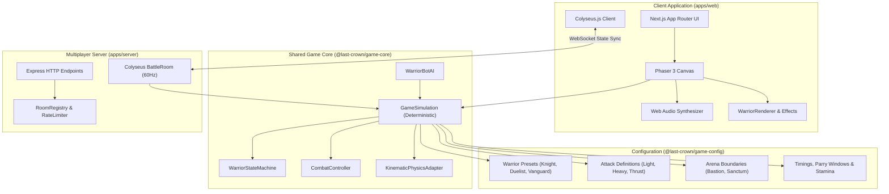

# Architecture Overview

## System Components

## Architectural Boundaries

1. **Presentation Separation**: React components in `apps/web` own page routing, menus, dialogue overlays, and settings. Phaser owns the real-time game canvas, sprite rendering, camera effects, and audio synthesis.
2. **Headless Game Core**: `@last-crown/game-core` contains zero references to DOM elements, browser APIs, React hooks, or server WebSockets. This allows identical combat code to run offline in the browser and headlessly inside Node.js server rooms.
3. **Zero Client Trust**: Damage calculations, collision confirmations, and state changes are executed exclusively by `GameSimulation`. In multiplayer, the server's simulation is authoritative.
