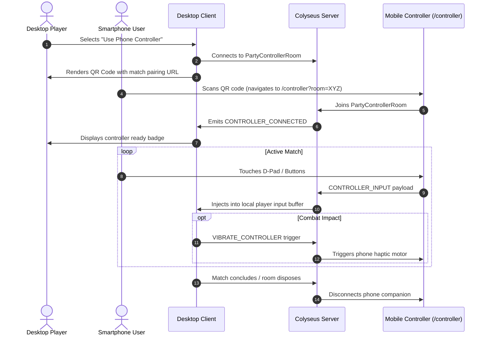

# Mobile & Responsive Architecture

LAST CROWN features dedicated mobile optimization supporting both **direct touch gameplay on mobile browsers** and **smartphone companion controllers** via QR code pairing.

---

## 1. Responsive Viewport & Orientation Management

### Dynamic Viewport Sizing (`100dvh`)

Traditional mobile browsers (iOS Mobile Safari, Android Chrome) collapse address bars dynamically during scroll or gesture, causing `100vh` to clip canvas boundaries.

- The game container enforces `100dvh` (Dynamic Viewport Height) with `viewportFit: cover`.
- Native gesture bouncing and pull-to-refresh are suppressed via CSS `overscroll-behavior: none` and `touch-action: none`.

### Landscape Mode Enforcement

Fighting games require 16:9 widescreen canvas geometry.

1. When a user loads `/play` or `/local` in portrait orientation on a phone or tablet:
   - A full-screen retro warning overlay appears: `"ROTATE DEVICE TO LANDSCAPE"`.
   - On devices supporting the Screen Orientation API, `screen.orientation.lock('landscape')` is requested during the initial user gesture.
2. In landscape mode:
   - The Phaser canvas scales to fit screen bounds with `Phaser.Scale.FIT` and `CENTER_BOTH`.
   - The on-screen arcade touch controls overlay directly onto the canvas with safe-area inset padding (`env(safe-area-inset-*)`).

---

## 2. Touch Controls & Pointer Events Engine

The mobile control overlay (`MobileGameControls.tsx`) is designed for competitive precision:

```text
┌────────────────────────────────────────────────────────────────────────┐
│ [PAUSE]                                                [VOICE] [FULL]  │
│                                                                        │
│                                   (CANVAS)                             │
│                                                                        │
│      [ JUMP ]                                     [ GUARD ] [ PARRY ]  │
│                                                                        │
│  [LEFT]    [RIGHT]                             [LIGHT]     [HEAVY]     │
│       [ DASH ]                                                         │
└────────────────────────────────────────────────────────────────────────┘
```

### Eliminating Ghost Clicks & Multi-Touch Dropouts

1. **Pure Pointer Events**:
   - Uses `onPointerDown`, `onPointerUp`, `onPointerCancel`, and `onPointerLeave` exclusively.
   - Dual `onTouch*` and `onClick` handlers are eliminated, preventing double-firing, simulated mouse delays (300ms click delay), and ghost touches.
2. **Ref-Based Direction State**:
   - Direction inputs (`leftPressedRef`, `rightPressedRef`) are held in React refs rather than re-rendering state.
   - Prevents stale closures where simultaneous multi-touch (e.g. Left + Jump) inadvertently cancels the horizontal movement vector.
3. **Hardware Haptics**:
   - Tactile feedback triggers via `navigator.vibrate(15)` on button contact without blocking main thread frame pacing.

---

## 3. Companion Smartphone Controller (`/controller`)

Players on desktop or TV displays can use their smartphone as a wireless physical gamepad without installing native apps:



### Security & Fault Tolerance

- **Host-Only Authorization**: Only the host session in `PartyControllerRoom` can trigger vibration or configuration changes.
- **WSS Reverse Proxy Routing**: Automatically detects production HTTPS/443 without appending local `:2567` ports.
- **Orphan Teardown**: When the desktop match ends, paired phone controllers are cleanly disconnected and redirected to the home lobby.
