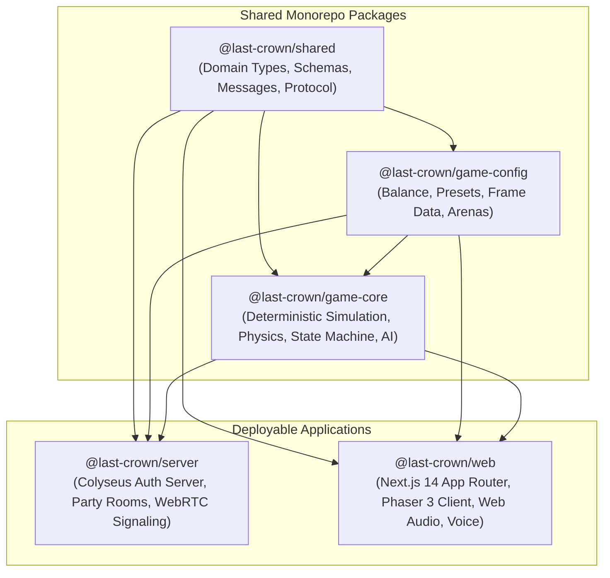
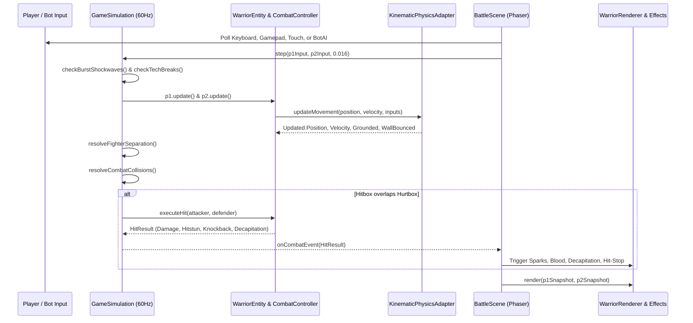

# Last-Crown — Comprehensive Codebase Architecture & File Documentation

> **Last-Crown: The winner takes it all**  
> _A high-performance, server-authoritative, zero-budget ($0) retro pixel-art browser fighting game._  
> Built with Next.js 14, Phaser 3, Colyseus, WebRTC Voice, Web Audio API, and TypeScript.

---

## Table of Contents

1. [Monorepo Architecture & System Overview](#1-monorepo-architecture--system-overview)
2. [High-Level Architectural Invariants](#2-high-level-architectural-invariants)
3. [Complete Codebase Directory Tree](#3-complete-codebase-directory-tree)
4. [Package: `@last-crown/shared`](#4-package-last-crownshared)
5. [Package: `@last-crown/game-config`](#5-package-last-crowngame-config)
6. [Package: `@last-crown/game-core`](#6-package-last-crowngame-core)
7. [App: `@last-crown/server`](#7-app-last-crownserver)
8. [App: `@last-crown/web`](#8-app-last-crownweb)
9. [Subsystem Deep Dives & Data Flows](#9-subsystem-deep-dives--data-flows)
   - [9.1 Game Simulation & Physics Loop](#91-game-simulation--physics-loop)
   - [9.2 Client-Server Authoritative Netcode Flow](#92-client-server-authoritative-netcode-flow)
   - [9.3 Mobile QR Party Controller Subsystem](#93-mobile-qr-party-controller-subsystem)
   - [9.4 WebRTC Peer-to-Peer Voice Chat Pipeline](#94-webrtc-peer-to-peer-voice-chat-pipeline)
   - [9.5 Procedural Canvas Rendering & Audio Synthesis Engine](#95-procedural-canvas-rendering--audio-synthesis-engine)
10. [Root Configuration & Deployment Infrastructure](#10-root-configuration--deployment-infrastructure)
11. [Developer Commands & Verification Reference](#11-developer-commands--verification-reference)

---

## 1. Monorepo Architecture & System Overview

`Last-Crown` is organized as an npm workspace monorepo consisting of **3 shared core packages** and **2 deployable applications**:



### Purpose of Workspaces

| Workspace                     | Directory                                                                               | Role & Tech Stack                                                                                                                                                                 |
| :---------------------------- | :-------------------------------------------------------------------------------------- | :-------------------------------------------------------------------------------------------------------------------------------------------------------------------------------- |
| **`@last-crown/shared`**      | [`packages/shared`](file:///c:/Users/Mahi/Desktop/last_crown/packages/shared)           | Shared TypeScript interfaces, Colyseus Schema definitions, network protocol message types, Zod validators, and player statistics management.                                      |
| **`@last-crown/game-config`** | [`packages/game-config`](file:///c:/Users/Mahi/Desktop/last_crown/packages/game-config) | Data-driven configuration files for warrior class presets, attack frame data, arena dimensions, and balance coefficients.                                                         |
| **`@last-crown/game-core`**   | [`packages/game-core`](file:///c:/Users/Mahi/Desktop/last_crown/packages/game-core)     | Pure, deterministic simulation engine: kinematic physics adapter, warrior state machine, combat collision resolution, Directional Influence (DI), and bot AI.                     |
| **`@last-crown/server`**      | [`apps/server`](file:///c:/Users/Mahi/Desktop/last_crown/apps/server)                   | Authoritative Colyseus multiplayer game server: room registry, 60Hz physics ticker, 30Hz network state synchronizer, WebRTC ICE signaling relay, and QR party controller room.    |
| **`@last-crown/web`**         | [`apps/web`](file:///c:/Users/Mahi/Desktop/last_crown/apps/web)                         | Next.js 14 web client: responsive pixel HUD, client-only Phaser 3 WebGL/Canvas game container, procedural sprite rendering, Web Audio API sound synthesis, and WebRTC voice chat. |

---

## 2. High-Level Architectural Invariants

1. **Deterministic Server-Authoritative Simulation**:
   - The same [`GameSimulation`](file:///c:/Users/Mahi/Desktop/last_crown/packages/game-core/src/simulation/GameSimulation.ts) runs on both client (for zero-latency offline duels and instant visual feedback) and server (for authoritative multiplayer validation).
   - The simulation runs at a fixed **60Hz** tick rate (`SIMULATION_TICK_RATE = 60`), advancing time in exact 16.6ms intervals regardless of display refresh rate.

2. **Network Sync Rate Separation**:
   - Physics simulation updates at 60Hz on the server, while Colyseus network state diffs are broadcast at **30Hz** (`NETWORK_SYNC_RATE = 30`) to conserve bandwidth and reduce mobile battery drain.
   - The client linearly interpolates (`lerp`) positions between snapshots to achieve silky-smooth **144Hz** display rendering.

3. **Zero-Asset Procedural Visuals & Audio**:
   - Warrior characters, longswords, cross-guards, plate armor, capes, severed heads, arterial blood spurts, and sparks are drawn programmatically using pure Phaser canvas geometry primitives via [`WarriorRenderer`](file:///c:/Users/Mahi/Desktop/last_crown/apps/web/src/game/rendering/WarriorRenderer.ts) and [`CombatEffects`](file:///c:/Users/Mahi/Desktop/last_crown/apps/web/src/game/effects/CombatEffects.ts).
   - Audio effects (sword swings, shield blocks, parry chimes, flesh hits, decapitations, crowd cheers) are synthesized purely through real-time mathematical oscillators and white-noise buffers via the Web Audio API in [`SoundManager`](file:///c:/Users/Mahi/Desktop/last_crown/apps/web/src/game/audio/SoundManager.ts).

4. **Zero-Budget ($0) Free Tier Architecture**:
   - Multiplayer WebSocket server runs cleanly on Render / Railway free tier.
   - Frontend and serverless API endpoints deploy to Vercel.
   - WebRTC voice uses free Google STUN servers with an optional Metered TURN fallback.

---

## 3. Complete Codebase Directory Tree

```
last_crown/
├── .editorconfig                       # Code style rules (indentation, charset, trim trailing whitespace)
├── .env.example                        # Environment template with server ports, CORS, and STUN/TURN credentials
├── .gitignore                          # Git ignore definitions (node_modules, .next, dist, coverage, logs)
├── .npmrc                              # NPM package manager configuration
├── .nvmrc                              # Enforces Node.js v20.x/22.x LTS
├── .prettierrc.json                    # Monorepo Prettier code style specification
├── CODE_OF_CONDUCT.md                  # Contributor Covenant code of conduct
├── CONTRIBUTING.md                     # Development contribution workflow and PR requirements
├── Dockerfile                          # Multi-stage production container build for @last-crown/server
├── LICENSE                             # MIT Open Source License
├── package.json                        # Monorepo root scripts, workspaces, and shared dev-dependencies
├── package-lock.json                   # Deterministic lockfile
├── playwright.config.ts                # Playwright E2E browser automation test configuration
├── README.md                           # Public repository overview, badges, features, and quickstart
├── render.yaml                         # Render Cloud Infrastructure as Code (IaC) configuration
├── SECURITY.md                         # Security vulnerability reporting policy
├── tsconfig.base.json                  # Root TypeScript compilation target, module resolution, and strict flags
├── vercel.json                         # Vercel deployment headers, caching, and rewrites
├── vitest.workspace.ts                 # Vitest multi-project workspace configuration
├── .github/
│   ├── ISSUE_TEMPLATE/                 # GitHub issue templates for bug reports and feature proposals
│   ├── PULL_REQUEST_TEMPLATE.md        # Comprehensive PR checklist and qualification template
│   └── workflows/
│       └── ci.yml                      # GitHub Actions CI matrix (Lint, Typecheck, Test, Build across Node 20 & 22)
├── docs/                               # Engineering documentation suite
│   ├── README.md                       # Documentation index
│   ├── architecture/                   # Architecture blueprints (game-loop, multiplayer, protocol, overview)
│   ├── audit/                          # Production readiness and qualification reports
│   ├── decisions/                      # Architecture Decision Records (ADRs 001–005)
│   ├── deployment/                     # Free-tier and production deployment operations
│   ├── game-design/                    # Combat system rules, mechanics, and frame data specifications
│   ├── mobile/                         # Mobile controller and forced-landscape architecture
│   ├── security/                       # Threat modeling and attack mitigation specifications
│   └── testing/                        # Automated testing strategy and coverage guidelines
├── packages/
│   ├── shared/                         # Workspace: @last-crown/shared
│   │   ├── package.json
│   │   ├── tsconfig.json
│   │   ├── vitest.config.ts
│   │   ├── src/
│   │   │   ├── index.ts                # Package entrypoint re-exporting all submodules
│   │   │   ├── constants/index.ts      # Protocol constants, tick rates, arena bounds, invite code charset
│   │   │   ├── domain/                 # Domain types, interfaces, and stats
│   │   │   ├── protocol/               # Client/Server message schemas and Zod validators
│   │   │   └── schemas/                # Colyseus Schema classes for state sync
│   │   └── tests/                      # Validation and statistics test suites
│   ├── game-config/                    # Workspace: @last-crown/game-config
│   │   ├── package.json
│   │   ├── tsconfig.json
│   │   ├── vitest.config.ts
│   │   ├── src/
│   │   │   ├── index.ts                # Re-exports warrior presets, attacks, balance, and arenas
│   │   │   ├── arenas.ts               # Arena boundary dimensions, floor/ceiling coordinates, themes
│   │   │   ├── attacks.ts              # AttackDefinitions, frame data (windup, active, recovery), hitboxes
│   │   │   ├── balance.ts              # Global combat constants, stamina rules, DI, Crown Burst params
│   │   │   └── warriors.ts             # Character class presets (Knight, Marauder, Duelist, Vanguard)
│   │   └── tests/                      # Config verification tests
│   └── game-core/                      # Workspace: @last-crown/game-core
│       ├── package.json
│       ├── tsconfig.json
│       ├── vitest.config.ts
│       ├── src/
│       │   ├── index.ts                # Core simulation re-exports
│       │   ├── ai/                     # Bot character AI and tactical stance behavior
│       │   ├── collision/              # AABB bounding boxes and directional hitbox calculations
│       │   ├── combat/                 # CombatController handling attacks, parries, blocks, clashes
│       │   ├── movement/               # MovementController managing positioning and facing
│       │   ├── physics/                # Kinematic physics adapter, gravity, and wall bounces
│       │   ├── simulation/             # WarriorEntity and GameSimulation master loop
│       │   └── state-machine/          # WarriorStateMachine managing valid action transitions
│       └── tests/                      # Simulation, AI, and collision unit tests
└── apps/
    ├── server/                         # Workspace: @last-crown/server
    │   ├── package.json
    │   ├── tsconfig.json
    │   ├── vitest.config.ts
    │   ├── src/
    │   │   ├── index.ts                # Server bootstrap, Express routes, Colyseus listener
    │   │   ├── config/env.ts           # Environment schema validation
    │   │   ├── matchmaking/            # RoomRegistry and active room tracking
    │   │   ├── rooms/                  # BattleRoom (1v1) & PartyControllerRoom (Phone QR Controller)
    │   │   ├── security/               # Invite code generator and in-memory rate limiter
    │   │   └── services/               # STUN/TURN ICE server configuration service
    │   └── tests/                      # Server integration and concurrency tests
    └── web/                            # Workspace: @last-crown/web
        ├── next.config.mjs             # Next.js configuration
        ├── package.json
        ├── tsconfig.json
        ├── vitest.config.ts
        ├── public/                     # Static icons, backgrounds, UI frames, and llms.txt files
        ├── src/
        │   ├── app/                    # Next.js 14 App Router pages, layouts, and API routes
        │   ├── components/             # Reusable UI widgets, modals, layout chrome
        │   ├── features/               # High-level feature controllers (game, voice, multiplayer)
        │   ├── game/                   # Phaser 3 scenes, canvas renderers, procedural audio, inputs
        │   ├── styles/                 # Global styles and CSS design tokens
        │   └── utils/                  # Fullscreen API and landscape orientation lock helpers
        └── tests/                      # Frontend unit and E2E specs
```

---

## 4. Package: `@last-crown/shared`

The [`@last-crown/shared`](file:///c:/Users/Mahi/Desktop/last_crown/packages/shared) package provides the canonical data contracts, message envelopes, and state schemas used across both client and server workspaces.

### Files Breakdown

#### [`src/constants/index.ts`](file:///c:/Users/Mahi/Desktop/last_crown/packages/shared/src/constants/index.ts)

Contains immutable system-wide constants:

- `PROTOCOL_VERSION = '1.0.0'`: Enforces version parity between client and server.
- `SIMULATION_TICK_RATE = 60`: 60 updates/sec (16.66ms delta) for physics and combat calculations.
- `NETWORK_SYNC_RATE = 30`: 30 snapshot syncs/sec for Colyseus state broadcasts.
- `MAX_PLAYERS_PER_ROOM = 2`: 1v1 duel constraint per match room.
- `INVITE_CODE_LENGTH = 6`, `INVITE_CODE_CHARSET = '23456789ABCDEFGHJKMNPQRSTUVWXYZ'`: 6-character room codes excluding ambiguous characters (`0`, `O`, `1`, `I`, `L`).
- Default game parameters: `DEFAULT_MAX_HEALTH = 100`, `DEFAULT_MAX_STAMINA = 100`, `DEFAULT_PARRY_WINDOW_MS = 150`, `DEFAULT_ARENA_WIDTH = 1280`, `DEFAULT_ARENA_HEIGHT = 720`, `DEFAULT_FLOOR_Y = 625`, `DEFAULT_GRAVITY = 1800`.

#### [`src/domain/types.ts`](file:///c:/Users/Mahi/Desktop/last_crown/packages/shared/src/domain/types.ts)

Core primitive mathematical and state models:

- `Direction`: `'left' | 'right'`.
- `Vector2`: `{ x: number; y: number }`.
- `AABB`: Axis-Aligned Bounding Box `{ minX: number; minY: number; maxX: number; maxY: number }`.
- `MatchState`: `'waiting' | 'countdown' | 'in_progress' | 'round_over' | 'match_over'`.
- `RoundResult`: Snapshot of a finished round `{ winnerId: string | null; p1Health: number; p2Health: number; isDraw: boolean }`.

#### [`src/domain/combat.ts`](file:///c:/Users/Mahi/Desktop/last_crown/packages/shared/src/domain/combat.ts)

Combat definitions and hit resolution models:

- `AttackPhase`: `'none' | 'windup' | 'active' | 'recovery'`.
- `AttackType`: `'light' | 'heavy' | 'thrust' | 'combo' | 'aerial' | 'dash' | 'sweep' | 'throw'`.
- `AttackDefinition`: Detailed attack property specification: damage, staminaCost, windupMs, activeMs, recoveryMs, hitbox bounds, offsets, knockback vector, and hitstunMs.
- `HitResolutionType`: `'hit' | 'blocked' | 'parried' | 'clash' | 'tech_break' | 'thrown' | 'whiff'`.
- `HitResult`: Full resolution packet returned when two hurtboxes/hitboxes collide:
  - `damage`, `blockedDamage`, `staminaDamage`, `knockback`, `hitstunMs`.
  - Flags: `isCritical`, `isRiposte`, `isCounterHit`, `isGuardCrush`, `isClash`, `isDecapitation`, `isWallBounce`, `isThrowTech`, `isBurstBreaker`.
- `HitboxInstance` & `HurtboxInstance`: Active spatial collision representations.

#### [`src/domain/warrior.ts`](file:///c:/Users/Mahi/Desktop/last_crown/packages/shared/src/domain/warrior.ts)

Warrior state contracts:

- `WarriorActionState`: `'idle' | 'walking' | 'running' | 'jumping' | 'attacking' | 'blocking' | 'parrying' | 'hitstun' | 'knocked_down' | 'dead'`.
- `WarriorAttributes`: Base attributes `{ maxHealth, maxStamina, walkSpeed, runSpeed, jumpVelocity, blockReduction }`.
- `WarriorSnapshot`: Complete serializable point-in-time state of a fighter for rendering and network sync.

#### [`src/domain/statistics.ts`](file:///c:/Users/Mahi/Desktop/last_crown/packages/shared/src/domain/statistics.ts)

Persistent player telemetry:

- `PlayerStatistics`: Tracks games played, wins, losses, win rate, win streak, perfect rounds, decapitations, parries, clashes, and damage dealt.
- `calculateWinRate(stats: PlayerStatistics): number`: Returns floating-point win percentage.
- `formatWinRate(winRate: number): string`: Formats percentage with one decimal place.
- `StatisticsManager`: Browser `localStorage` persistence layer with fallback to memory; validates schema integrity with Zod.

#### [`src/protocol/messages.ts`](file:///c:/Users/Mahi/Desktop/last_crown/packages/shared/src/protocol/messages.ts)

Network envelope type definitions:

- `ClientMessageType`:
  - `PLAYER_INPUT`: Serialized client inputs (`sequence`, `timestamp`, `moveX`, `moveY`, `jump`, `dash`, `attack`, `attackType`, `block`, `parry`, `burst`, `throw`).
  - `PING`, `REMATCH_REQUEST`, `VOICE_SIGNAL`.
- `ServerMessageType`:
  - `PONG`, `COMBAT_EVENT`, `ROUND_START`, `ROUND_END`, `MATCH_END`, `PLAYER_DISCONNECTED`, `PLAYER_RECONNECTED`, `OPPONENT_LEFT`, `MATCH_QUEUE_STATUS`, `ERROR`, `VOICE_SIGNAL`.
- `PartyMessageType`:
  - Message identifiers for smartphone QR party controller connections (`CLAIM_SLOT`, `SLOT_STATE`, `CONTROLLER_INPUT`, `VIBRATE`, `START_MATCH`).

#### [`src/protocol/validation.ts`](file:///c:/Users/Mahi/Desktop/last_crown/packages/shared/src/protocol/validation.ts)

Zod validation schemas for all inputs crossing trust boundaries:

- `InviteCodeSchema`: Validates 6-character alphanumeric uppercase codes.
- `PlayerInputSchema`: Validates sequence numbers, timestamps, and input booleans.
- `CreateRoomSchema` & `JoinRoomSchema`: Validates room creation options and display names.

#### [`src/schemas/`](file:///c:/Users/Mahi/Desktop/last_crown/packages/shared/src/schemas)

Colyseus synchronized state schema models:

- [`WarriorNetworkState.ts`](file:///c:/Users/Mahi/Desktop/last_crown/packages/shared/src/schemas/WarriorNetworkState.ts): Synced warrior fields (id, name, preset, position x/y, velocity x/y, facing, health, stamina, burstMeter, state, attackPhase, comboCount, isDecapitated, etc.).
- [`HitboxNetworkState.ts`](file:///c:/Users/Mahi/Desktop/last_crown/packages/shared/src/schemas/HitboxNetworkState.ts): Synced hitbox bounds and attack identification.
- [`BattleRoomState.ts`](file:///c:/Users/Mahi/Desktop/last_crown/packages/shared/src/schemas/BattleRoomState.ts): Master synced room state containing `p1`, `p2`, `roundNumber`, `roundTimerSec`, `matchState`, `winnerId`, `arenaId`, `p1RoundWins`, `p2RoundWins`.

---

## 5. Package: `@last-crown/game-config`

The [`@last-crown/game-config`](file:///c:/Users/Mahi/Desktop/last_crown/packages/game-config) package houses pure game design configuration, character balance parameters, attack frame data, and arena specifications.

### Files Breakdown

#### [`src/warriors.ts`](file:///c:/Users/Mahi/Desktop/last_crown/packages/game-config/src/warriors.ts)

Defines the 4 playable medieval champion classes:

1. **The Crown Knight** (`knight`):
   - Balanced swordmaster wielding a two-handed longsword.
   - High guard defense (`blockReduction: 0.80`), balanced mobility, and the _Bastion Riposte_ passive (recovers 20 SP and bonus burst on successful parry).
2. **The Marauder** (`marauder`):
   - Aggressive berserker with high health (`maxHealth: 115`) and heavy strikes.
   - Low block efficiency (`blockReduction: 0.65`), high offensive burst, and _Blood Siphon_ passive (recovers 6 HP on clean counter-hits).
3. **The Royal Duelist** (`duelist`):
   - High-agility fencing specialist with fast movement (`walkSpeed: 270`, `runSpeed: 440`) and rapid light thrusts.
   - Lower health (`maxHealth: 90`), fast stamina regeneration, and _Quickstep Advantage_ passive.
4. **The Iron Vanguard** (`vanguard`):
   - Heavily armored defensive juggernaut (`maxHealth: 120`, `blockReduction: 0.85`).
   - Slower movement, massive execution damage, and _Unstoppable Poise_ resistance to light attacks.

#### [`src/attacks.ts`](file:///c:/Users/Mahi/Desktop/last_crown/packages/game-config/src/attacks.ts)

Defines frame data and properties for all combat actions:

- `light_slash`: Quick horizontal cut (160ms windup, 120ms active, 220ms recovery, 14 dmg, 35 px/s knockback).
- `heavy_strike`: Devastating overhead blow (340ms windup, 160ms active, 400ms recovery, 28 dmg, 65 px/s knockback, triggers decapitation on lethal).
- `thrust`: Extended lunging poke (220ms windup, 100ms active, 280ms recovery, 18 dmg, 50 px/s knockback).
- `slash_combo_2`: Rising follow-up slash for combo chains (130ms windup, 110ms active, 200ms recovery, 16 dmg).
- `spinning_finisher`: 360-degree high-impact combo closer (180ms windup, 150ms active, 260ms recovery, 24 dmg).
- `aerial_strike` (_Helm Splitter_): Downward diving mid-air cleave (140ms windup, 160ms active, 230ms recovery, 24 dmg).
- `dash_lunge`: Surprise attack executed during evasive slides (120ms windup, 100ms active, 240ms recovery, 19 dmg).
- `low_sweep`: Low leg sweep that bypasses standing block (180ms windup, 110ms active, 260ms recovery, 16 dmg).
- `command_throw`: Close-quarters grab (120ms windup, 80ms active, 260ms recovery, 22 dmg, tech-breakable).

#### [`src/arenas.ts`](file:///c:/Users/Mahi/Desktop/last_crown/packages/game-config/src/arenas.ts)

Configurations for the 4 battle arenas:

- `coloseum`: Grand stone arena with open skies and imperial torches.
- `mossy_castle`: Weathered ancient fortress with climbing ivy and gothic pillars.
- `emerald_fortress`: Subterranean vault with glowing emerald brazier lanterns.
- `royal_chamber`: Ornate castle throne room with hanging banners and castle guards.
- Provides `getArenaConfig(id: string)`: Resolves arena boundaries (`leftBoundX: 60`, `rightBoundX: 1220`, `floorY: 625`, `ceilingY: 100`).

#### [`src/balance.ts`](file:///c:/Users/Mahi/Desktop/last_crown/packages/game-config/src/balance.ts)

Centralized combat tuning constants:

- **Combat Mechanics**:
  - `parryWindowMs: 150`: Exact timing window where parry is active.
  - `parryCounterStunMs: 650`: Attacker stagger duration upon being parried.
  - `blockDamageReduction: 0.75`, `blockChipDamageMultiplier: 0.25`: Damage absorption calculations.
  - `staminaDepletedExhaustionMs: 1200`: Duration of vulnerability if stamina hits 0.
  - `clashRecoilImpulse: 60`, `clashRecoilStunMs: 220`: Weapon clash recoil.
  - `counterHitDamageMultiplier: 1.25`, `counterHitStunBonusMs: 100`: Counter-hit rewards.
  - `directionalInfluenceFactor: 0.1`: Trajectory adjustment ratio while in hitstun.
  - `burstMaxMeter: 100`, `burstShockwaveRadius: 180`, `burstShockwaveImpulse: 200`: Crown Burst combo-breaker parameters.
- **Physics Mechanics**:
  - `groundAcceleration: 1800`, `skidDeceleration: 3400`, `frictionX: 0.82`, `airFrictionX: 0.94`, `gravity: 1800`.
  - `wallBounceVelocityThreshold: 140`, `wallBounceRestitution: 0.4`: Kinetic boundary bouncing.
  - `fighterSeparationDistance: 44`, `fighterPushSpeed: 140`: Soft-body separation to prevent sprite clipping.

---

## 6. Package: `@last-crown/game-core`

The [`@last-crown/game-core`](file:///c:/Users/Mahi/Desktop/last_crown/packages/game-core) package is the deterministic combat engine. It has **zero dependencies on the DOM, Node, or Phaser**, allowing it to execute identically in browser web workers, main thread contexts, and server environments.

### Files Breakdown

#### [`src/collision/aabb.ts`](file:///c:/Users/Mahi/Desktop/last_crown/packages/game-core/src/collision/aabb.ts)

Geometric intersection calculations:

- `checkAABBOverlap(a: AABB, b: AABB): boolean`: Fast separating-axis test for two boxes.
- `computeHurtboxAABB(position: Vector2, width: number, height: number): AABB`: Calculates fighter body hurtbox centered horizontally on origin.
- `computeDirectionalHitboxAABB(...)`: Computes attack sword hitbox mirrored correctly based on warrior facing (`left` or `right`).

#### [`src/physics/IPhysicsAdapter.ts`](file:///c:/Users/Mahi/Desktop/last_crown/packages/game-core/src/physics/IPhysicsAdapter.ts) & [`src/physics/KinematicPhysicsAdapter.ts`](file:///c:/Users/Mahi/Desktop/last_crown/packages/game-core/src/physics/KinematicPhysicsAdapter.ts)

Kinematic physics integration:

- `updateMovement(...)`: Applies horizontal acceleration, skid braking, air drag, variable jump cuts (releasing jump early cuts vertical velocity), tactical fast-fall (pressing down in mid-air multiplies fall speed by 1.85x), floor collision clamping, and wall bounces.
- `applyImpulse(currentVelocity: Vector2, impulse: Vector2): Vector2`: Adds vector momentum directly to velocity.

#### [`src/state-machine/WarriorStateMachine.ts`](file:///c:/Users/Mahi/Desktop/last_crown/packages/game-core/src/state-machine/WarriorStateMachine.ts)

Finite State Machine enforcing strict action validity:

- Validates state transitions via an internal adjacency matrix (e.g., cannot transition from `hitstun` to `attacking` without completing stun duration).
- Exposes `canTransitionTo(next)`, `transitionTo(next)`, and `forceState(state)`.

#### [`src/combat/CombatController.ts`](file:///c:/Users/Mahi/Desktop/last_crown/packages/game-core/src/combat/CombatController.ts)

Stateful combat manager attached to every warrior:

- Tracks attack phases (`windup`, `active`, `recovery`) and timers.
- Manages parry vulnerability windows, hitstun timers, and stamina regeneration delays.
- `resolveIncomingHit(...)`: Determines whether an attack is clean, blocked, parried, or a counter-hit. Calculates critical damage, ripostes, and posture breaks.
- `feintAttack(...)`: Cancels an attack during windup with a dash or block at the cost of 10 SP.

#### [`src/movement/MovementController.ts`](file:///c:/Users/Mahi/Desktop/last_crown/packages/game-core/src/movement/MovementController.ts)

Encapsulates fighter spatial properties:

- Maintains `position`, `velocity`, `facing`, and grounded status.
- Integrates with `IPhysicsAdapter` on each simulation step.

#### [`src/ai/WarriorBotAI.ts`](file:///c:/Users/Mahi/Desktop/last_crown/packages/game-core/src/ai/WarriorBotAI.ts)

Adaptive bot AI rival with four selectable difficulty tiers:

- **Difficulties**: `novice`, `adept`, `expert`, and `master`.
- **Tactical Behaviors**:
  - _Windup Tracking_: Reads human player attack windup in real time. Decides to parry, jump over, or block based on reaction delay profiles.
  - _Shield Cracking_: Sweeps low when human players turtle behind high blocks.
  - _Corner Escape_: Executes tactical forward jump-dashes when trapped against arena boundaries.
  - _Whiff Punishment_: Recognizes opponent recovery frames and dashes in with forward thrusts.
  - _Bloodlust Executioner_: Increases aggression and executes heavy finishers when opponent is exhausted or near zero HP.

#### [`src/simulation/WarriorEntity.ts`](file:///c:/Users/Mahi/Desktop/last_crown/packages/game-core/src/simulation/WarriorEntity.ts)

Complete warrior actor combining Movement, Combat, and State Machine:

- Encapsulates health, stamina, burst meter, and hurtbox calculations.
- `processInput(input: PlayerInputMessage)`: Decodes and buffers player actions into physical motions, attacks, dashes, parries, blocks, or Crown Burst triggers.
- `applyDamage(amount)`, `applyStaminaDamage(amount)`: Modifies vital resources.

#### [`src/simulation/GameSimulation.ts`](file:///c:/Users/Mahi/Desktop/last_crown/packages/game-core/src/simulation/GameSimulation.ts)

The master deterministic simulation container:

- Holds `p1`, `p2`, `arena`, and `_physics`.
- `step(p1Input, p2Input, deltaSec)`: Advances the game state by one fixed tick:
  1. Checks Crown Burst shockwaves and command grab tech breaks.
  2. Updates warrior physics, movement, and stamina.
  3. Applies soft-body fighter separation to prevent overlapping.
  4. Checks boundary collisions and kinetic wall bounces.
  5. Resolves combat collisions (weapon clashes, clean hits, parries, blocks).
  6. Checks round conditions (win, loss, double KO draw, sudden death tiebreakers).
- `getSnapshot(): GameSimulationSnapshot`: Serializes full match state for network broadcast or client HUD rendering.

---

## 7. App: `@last-crown/server`

The [`@last-crown/server`](file:///c:/Users/Mahi/Desktop/last_crown/apps/server) application is an authoritative Colyseus Node.js server handling matchmaking, room lifecycle, WebRTC signaling, and smartphone QR party controllers.

### Files Breakdown

#### [`src/config/env.ts`](file:///c:/Users/Mahi/Desktop/last_crown/apps/server/src/config/env.ts)

Validates environment variables at startup using Zod:

- `PORT` (defaults to 2567).
- `CORS_ORIGIN` (allowed web frontend origins).
- `METERED_API_KEY` (optional TURN server integration).
- `LOG_LEVEL` (`debug`, `info`, `warn`, `error`).

#### [`src/security/InviteCodeGenerator.ts`](file:///c:/Users/Mahi/Desktop/last_crown/apps/server/src/security/InviteCodeGenerator.ts)

Cryptographically secure 6-character room invite code generator:

- Uses `crypto.randomInt` with the unambiguous character set.
- Guaranteed to produce human-readable, easy-to-type codes for mobile and desktop players.

#### [`src/security/RateLimiter.ts`](file:///c:/Users/Mahi/Desktop/last_crown/apps/server/src/security/RateLimiter.ts)

In-memory token bucket rate limiter:

- Guards room creation and verification HTTP endpoints from denial-of-service spam.
- Automatically cleans up expired IP token entries.

#### [`src/services/IceServerService.ts`](file:///c:/Users/Mahi/Desktop/last_crown/apps/server/src/services/IceServerService.ts)

Generates WebRTC ICE server configurations:

- Returns Google STUN servers by default (`stun:stun.l.google.com:19302`).
- Dynamically retrieves time-limited ephemeral TURN credentials from Metered.ca if `METERED_API_KEY` is configured, ensuring peer-to-peer voice works across restrictive firewalls and symmetric NATs.

#### [`src/matchmaking/RoomRegistry.ts`](file:///c:/Users/Mahi/Desktop/last_crown/apps/server/src/matchmaking/RoomRegistry.ts)

Thread-safe in-memory room tracker:

- Maps 6-character invite codes to active Colyseus `roomId`s.
- Tracks player occupancy, room creation timestamps, and handles stale room garbage collection.

#### [`src/rooms/BattleRoom.ts`](file:///c:/Users/Mahi/Desktop/last_crown/apps/server/src/rooms/BattleRoom.ts)

Authoritative 1v1 multiplayer combat room:

- `onCreate(options)`: Initializes `BattleRoomState`, generates invite code, and registers with `RoomRegistry`.
- `registerMessageHandlers()`:
  - `PLAYER_INPUT`: Validates and queues client input packets.
  - `VOICE_SIGNAL`: Relays WebRTC SDP offers, answers, and ICE candidate exchange between peer fighters.
  - `REMATCH_REQUEST`: Handles consensus for replaying a match.
- `onJoin(client)`: Assigns `p1` or `p2` slot. Starts quickmatch countdown or waits for private lobby readiness.
- `startMatch()`: Spawns the authoritative `GameSimulation` instance.
- **Simulation Loop**: Ticks simulation at **60Hz** via `setSimulationInterval`.
- **Network Broadcast**: Synchronizes Colyseus Schema changes at **30Hz**.
- `onLeave(client, consented)`: Provides a 10-second reconnection grace period for unintentional drops before awarding a forfeit win to the connected player.

#### [`src/rooms/PartyControllerRoom.ts`](file:///c:/Users/Mahi/Desktop/last_crown/apps/server/src/rooms/PartyControllerRoom.ts)

Local multiplayer smartphone controller pairing room:

- Acts as a real-time bridge allowing two players to scan a desktop QR code with mobile browsers and use their phones as wireless haptic gamepads.
- Maps mobile touches to `P1` and `P2` inputs on the desktop game.
- Dispatches vibration haptic feedback commands back to mobile phones on hits, parries, and match endings.

#### [`src/index.ts`](file:///c:/Users/Mahi/Desktop/last_crown/apps/server/src/index.ts)

Express + Colyseus bootstrap entrypoint:

- Configures CORS, Helmet, and JSON parsing.
- Exposes REST endpoints:
  - `GET /health`: Healthcheck for deployment monitoring.
  - `POST /api/rooms/create`: Creates private battle rooms.
  - `POST /api/rooms/verify`: Verifies 6-character invite codes before client socket connection.
  - `GET /api/ice-servers`: Fetches STUN/TURN configurations.
- Attaches Colyseus WebSocket server to HTTP server and handles graceful shutdown signals (`SIGTERM`, `SIGINT`).

---

## 8. App: `@last-crown/web`

The [`@last-crown/web`](file:///c:/Users/Mahi/Desktop/last_crown/apps/web) application is the Next.js 14 frontend, featuring server-rendered SEO landing pages, client-only Phaser 3 WebGL combat views, Web Audio API synthesis, and WebRTC voice chat.

### Subsystems & Files Breakdown

#### App Router Pages (`src/app/`)

- [`src/app/layout.tsx`](file:///c:/Users/Mahi/Desktop/last_crown/apps/web/src/app/layout.tsx): Root layout with metadata, Google Fonts preconnect (`Press Start 2P`, `VT323`), OpenGraph tags, and JSON-LD structured schema for search engines.
- [`src/app/page.tsx`](file:///c:/Users/Mahi/Desktop/last_crown/apps/web/src/app/page.tsx): Main retro landing page with game feature highlights, developer lore, keyboard controls cheat-sheet, and interactive mode launcher.
- [`src/app/game/page.tsx`](file:///c:/Users/Mahi/Desktop/last_crown/apps/web/src/app/game/page.tsx): Interactive retro arcade cover menu (`cover1` -> `transition` -> `cover2`) launching AI duels, local duels, or online rooms.
- [`src/app/play/page.tsx`](file:///c:/Users/Mahi/Desktop/last_crown/apps/web/src/app/play/page.tsx): Client-side Phaser game launcher for singleplayer AI battles with URL parameter parsing (`arena`, `bot`, `difficulty`).
- [`src/app/arcade/page.tsx`](file:///c:/Users/Mahi/Desktop/last_crown/apps/web/src/app/arcade/page.tsx): Arcade Gauntlet mode featuring ladder progression across all 4 bot rivals.
- [`src/app/training/page.tsx`](file:///c:/Users/Mahi/Desktop/last_crown/apps/web/src/app/training/page.tsx): Training Dojo featuring attack frame data overlays, dummy AI stance toggles, and infinite stamina options.
- [`src/app/local/page.tsx`](file:///c:/Users/Mahi/Desktop/last_crown/apps/web/src/app/local/page.tsx): Local 2-Player couch multiplayer interface with on-screen QR codes for smartphone wireless controllers or dual gamepad input.
- [`src/app/room/page.tsx`](file:///c:/Users/Mahi/Desktop/last_crown/apps/web/src/app/room/page.tsx): Online multiplayer lobby handling room creation, invite code entry, and WebRTC voice chat status.
- [`src/app/controller/page.tsx`](file:///c:/Users/Mahi/Desktop/last_crown/apps/web/src/app/controller/page.tsx): Dedicated smartphone web controller interface featuring a touch D-Pad, combat action buttons, and Vibration API haptics.
- [`src/app/settings/page.tsx`](file:///c:/Users/Mahi/Desktop/last_crown/apps/web/src/app/settings/page.tsx): User settings panel for audio volume, control scheme remapping, and graphics quality.
- [`src/app/about/page.tsx`](file:///c:/Users/Mahi/Desktop/last_crown/apps/web/src/app/about/page.tsx): Server-rendered developer biography page honoring **Mujahid Al Mahi** and **Shahariar Hossain Jibon**.
- [`src/app/robots.ts`](file:///c:/Users/Mahi/Desktop/last_crown/apps/web/src/app/robots.ts) & [`src/app/sitemap.ts`](file:///c:/Users/Mahi/Desktop/last_crown/apps/web/src/app/sitemap.ts): SEO and search engine crawler instructions.

#### Components (`src/components/`)

- [`src/components/ui/PixelButton.tsx`](file:///c:/Users/Mahi/Desktop/last_crown/apps/web/src/components/ui/PixelButton.tsx): Retro emerald and ruby stone button widget with 9-slice drop-shadows and hover effects.
- [`src/components/arena/ArenaSelectModal.tsx`](file:///c:/Users/Mahi/Desktop/last_crown/apps/web/src/components/arena/ArenaSelectModal.tsx): Visual modal for previewing and picking battle environments.
- [`src/components/bot/BotSelectModal.tsx`](file:///c:/Users/Mahi/Desktop/last_crown/apps/web/src/components/bot/BotSelectModal.tsx): Modal for selecting bot difficulty and character personality.
- [`src/components/warrior/WarriorSelectModal.tsx`](file:///c:/Users/Mahi/Desktop/last_crown/apps/web/src/components/warrior/WarriorSelectModal.tsx): Champion selection modal displaying attributes, passives, and weapon styles.
- [`src/components/layout/ForcedLandscapeView.tsx`](file:///c:/Users/Mahi/Desktop/last_crown/apps/web/src/components/layout/ForcedLandscapeView.tsx): Screen orientation barrier instructing mobile users in portrait orientation to rotate their devices.

#### Features (`src/features/`)

- [`src/features/game/PhaserGameContainer.tsx`](file:///c:/Users/Mahi/Desktop/last_crown/apps/web/src/features/game/PhaserGameContainer.tsx):
  - Next.js dynamic client wrapper ensuring Phaser only initializes in browser environments (`ssr: false`).
  - Manages landscape fullscreen requests, window resize handling, and throttles React state updates to 60 FPS to leave maximum CPU/GPU frame budget for 144Hz canvas rendering.
- [`src/features/game/GameHUD.tsx`](file:///c:/Users/Mahi/Desktop/last_crown/apps/web/src/features/game/GameHUD.tsx):
  - High-performance React HUD overlay rendering pixel health bars with chip-damage ghosting, stamina gauges, Crown Burst bars, round diamonds, combo hit counters, and victory fanfare cards.
- [`src/features/game/MobileGameControls.tsx`](file:///c:/Users/Mahi/Desktop/last_crown/apps/web/src/features/game/MobileGameControls.tsx):
  - Touch-friendly virtual D-pad and attack buttons for mobile browser gameplay.
- [`src/features/multiplayer/useMultiplayerRoom.ts`](file:///c:/Users/Mahi/Desktop/last_crown/apps/web/src/features/multiplayer/useMultiplayerRoom.ts):
  - React hook managing Colyseus connection lifecycle, state listeners, and room error handling.
- [`src/features/voice/useVoiceChat.ts`](file:///c:/Users/Mahi/Desktop/last_crown/apps/web/src/features/voice/useVoiceChat.ts):
  - Production-grade WebRTC peer-to-peer voice communication hook.
  - Features SDP Opus bitrate tuning (`tuneOpusSDP`), local/remote voice activity detection (VAD) via `AnalyserNode`, deafen/mute controls, and automatic renegotiation watchdog.

#### Phaser Game Subsystem (`src/game/`)

- [`src/game/bootstrap/GameBootstrap.ts`](file:///c:/Users/Mahi/Desktop/last_crown/apps/web/src/game/bootstrap/GameBootstrap.ts): Initializes and destroys the `Phaser.Game` instance cleanly across React page navigations.
- [`src/game/config/phaserConfig.ts`](file:///c:/Users/Mahi/Desktop/last_crown/apps/web/src/game/config/phaserConfig.ts): Phaser 3 configuration targeting WebGL with Canvas fallback, fixed 1280x720 internal canvas resolution, and `FIT` scale mode.
- [`src/game/scenes/BootScene.ts`](file:///c:/Users/Mahi/Desktop/last_crown/apps/web/src/game/scenes/BootScene.ts): Preloads background image textures and starts `BattleScene`.
- [`src/game/scenes/BattleScene.ts`](file:///c:/Users/Mahi/Desktop/last_crown/apps/web/src/game/scenes/BattleScene.ts):
  - The core Phaser scene.
  - Manages input polling, simulation step execution, renderer updates, camera shakes, slow-motion hit-stops, torch flickering, floating embers, and combat event dispatches.
- [`src/game/rendering/WarriorRenderer.ts`](file:///c:/Users/Mahi/Desktop/last_crown/apps/web/src/game/rendering/WarriorRenderer.ts):
  - Pure procedural canvas renderer creating authentic 16-bit medieval warriors:
    - Great Helm with eye slits, golden crown accents, forged longsword, cross-guard, flanged pauldrons, and cloth capes with dynamic Verlet point physics.
    - Accurately renders combat states: slash animations, thrust lunges, low sweeps, shield blocking posture, exhaustion breathing, and decapitation stumps.
- [`src/game/effects/CombatEffects.ts`](file:///c:/Users/Mahi/Desktop/last_crown/apps/web/src/game/effects/CombatEffects.ts):
  - Visual particle and decal engine:
    - Severed heads with independent physics trajectories, gravity, and ground bounces.
    - Arterial blood squirts and permanent floor blood splatter decals.
    - Yellow/white weapon clash sparks, blue parry shield shockwaves, and critical hit counter flashes.
- [`src/game/audio/SoundManager.ts`](file:///c:/Users/Mahi/Desktop/last_crown/apps/web/src/game/audio/SoundManager.ts):
  - Web Audio API synthesizer generating responsive 8-bit/16-bit sound effects entirely in memory:
    - Sword whooshes, metal clangs, parry chimes, flesh cuts, decapitation slashes, low sweep trips, crowd cheers, low-health heartbeat pulses, and sudden death gongs.
- [`src/game/input/KeyboardInputAdapter.ts`](file:///c:/Users/Mahi/Desktop/last_crown/apps/web/src/game/input/KeyboardInputAdapter.ts):
  - Captures keyboard inputs (`WASD`, `JKL`, `Space`, `I`, `C`, `E`, `U`), maintains attack buffers, and detects double-tap dash gestures.
- [`src/game/input/GamepadInputAdapter.ts`](file:///c:/Users/Mahi/Desktop/last_crown/apps/web/src/game/input/GamepadInputAdapter.ts):
  - Standard HTML5 Gamepad API adapter with analog stick deadzones and vibration rumble feedback.
- [`src/game/input/DualPlayerInputManager.ts`](file:///c:/Users/Mahi/Desktop/last_crown/apps/web/src/game/input/DualPlayerInputManager.ts):
  - Multiplexes inputs for local 2-player mode on a single machine:
    - Splits Keyboard into P1 (`WASD` + `F/G/H/R/T`) and P2 (`Arrows` + `Numpad` / `KL;OP`), or seamlessly assigns connected gamepads.
- [`src/game/input/PartyControllerBridge.ts`](file:///c:/Users/Mahi/Desktop/last_crown/apps/web/src/game/input/PartyControllerBridge.ts):
  - Client singleton communicating with `PartyControllerRoom` to receive mobile web controller inputs over WebSockets.

---

## 9. Subsystem Deep Dives & Data Flows

### 9.1 Game Simulation & Physics Loop



### 9.2 Client-Server Authoritative Netcode Flow

```mermaid
sequenceDiagram
    participant C1 as Client 1 (P1)
    participant S as Server (BattleRoom 60Hz)
    participant C2 as Client 2 (P2)

    C1->>S: send("input", PlayerInputMessage { seq: 101, moveX: 1, attack: true })
    C2->>S: send("input", PlayerInputMessage { seq: 84, block: true })

    rect rgb(20, 25, 35)
        Note over S: Server Simulation Tick (60Hz)
        S->>S: GameSimulation.step(p1Input, p2Input, 0.016)
        S->>S: Check Hitboxes & Resolve Combat
    end

    rect rgb(25, 30, 45)
        Note over S: Network Sync Tick (30Hz)
        S-->>C1: Colyseus State Diff (p1.x, p2.x, health, burst)
        S-->>C2: Colyseus State Diff (p1.x, p2.x, health, burst)
    end

    alt Combat Event Occurred
        S-->>C1: send("combat_event", HitResult)
        S-->>C2: send("combat_event", HitResult)
    end

    C1->>C1: Lerp positions to 144Hz & Trigger Local Effects
    C2->>C2: Lerp positions to 144Hz & Trigger Local Effects
```



### 9.3 Mobile QR Party Controller Subsystem

1. **Host Setup**:
   - The desktop host visits `/local` and initiates a party room.
   - The host calls [`PartyControllerBridge.connectHost(partyCode)`](file:///c:/Users/Mahi/Desktop/last_crown/apps/web/src/game/input/PartyControllerBridge.ts), generating a unique on-screen QR code pointing to `https://last-crown.top/controller?room=CODE`.
2. **Mobile Connection**:
   - Players scan the QR code on iOS or Android.
   - The mobile browser opens [`/controller`](file:///c:/Users/Mahi/Desktop/last_crown/apps/web/src/app/controller/page.tsx), claims slot `p1` or `p2`, and renders a full-screen retro gamepad.
3. **Input Transmission**:
   - Touch gestures on the virtual D-Pad and action buttons are transmitted at 60Hz over WebSockets to [`PartyControllerRoom`](file:///c:/Users/Mahi/Desktop/last_crown/apps/server/src/rooms/PartyControllerRoom.ts).
4. **Desktop Dispatch & Haptics**:
   - The host room receives inputs and feeds them directly into [`DualPlayerInputManager`](file:///c:/Users/Mahi/Desktop/last_crown/apps/web/src/game/input/DualPlayerInputManager.ts).
   - When a player takes damage or parries, the host sends a `VIBRATE` message back, triggering the smartphone's `navigator.vibrate` motor.

### 9.4 WebRTC Peer-to-Peer Voice Chat Pipeline

1. **Signaling Exchange**:
   - Inside [`useVoiceChat`](file:///c:/Users/Mahi/Desktop/last_crown/apps/web/src/features/voice/useVoiceChat.ts), fighters connect to Colyseus [`BattleRoom`](file:///c:/Users/Mahi/Desktop/last_crown/apps/server/src/rooms/BattleRoom.ts).
   - Peer A creates an SDP Offer, tunes the Opus audio codec to 32 kbps mono (`tuneOpusSDP`), and sends it through Colyseus via `VOICE_SIGNAL`.
   - Peer B receives the offer, applies it as remote description, generates an SDP Answer, and returns it.
   - ICE candidates are exchanged asynchronously through the Colyseus relay.
2. **Audio Processing**:
   - Local microphone stream is routed through an `AudioContext` and `AnalyserNode` to calculate real-time RMS voice volume.
   - When volume exceeds the speaking threshold, `isUserSpeaking` is set to `true`, displaying glowing voice indicators on the HUD.
   - Deafen and mute toggles instantly disable media tracks or mute output audio elements.

### 9.5 Procedural Canvas Rendering & Audio Synthesis Engine

- **Sprite Generation ([`WarriorRenderer.ts`](file:///c:/Users/Mahi/Desktop/last_crown/apps/web/src/game/rendering/WarriorRenderer.ts))**:
  - Eliminates sprite-sheet HTTP loading delays and pixel-blur scaling artifacts.
  - Draws warriors layer-by-layer: drop shadow oval -> dynamic cloth cape -> boots and greaves -> chest plate with golden cross -> arms and gauntlets -> two-handed broadsword with metallic specular highlight -> Great Helm with visor slit.
  - Dynamic physics: Cape nodes simulate inertia and wind resistance based on warrior movement velocity.
- **Audio Generation ([`SoundManager.ts`](file:///c:/Users/Mahi/Desktop/last_crown/apps/web/src/game/audio/SoundManager.ts))**:
  - `playSwordSwing()`: Sweeps a bandpass filter over white noise while pitching an oscillator down from 480Hz to 120Hz.
  - `playBlockClang()`: Triggers two high-frequency metallic square wave oscillators at 1800Hz and 2400Hz with exponential decay.
  - `playParryChime()`: Produces a golden crystalline chord using sine oscillators at 880Hz, 1320Hz, and 1760Hz with shimmering gain envelopes.
  - `playDecapitationSlash()`: Combines low-end impact thump (80Hz), high-velocity slicing noise, and subsequent squishing arterial spurts.

---

## 10. Root Configuration & Deployment Infrastructure

### Configuration Files

- [`package.json`](file:///c:/Users/Mahi/Desktop/last_crown/package.json): Defines npm workspaces (`packages/*`, `apps/*`), dependency resolutions, and monorepo orchestration scripts.
- [`tsconfig.base.json`](file:///c:/Users/Mahi/Desktop/last_crown/tsconfig.base.json): Shared TypeScript configuration enforcing `ES2022` target, `NodeNext` module resolution, strict null checks, and isolated modules.
- [`vitest.workspace.ts`](file:///c:/Users/Mahi/Desktop/last_crown/vitest.workspace.ts): Coordinates fast unit and integration testing across all 5 workspace projects simultaneously.
- [`eslint.config.mjs`](file:///c:/Users/Mahi/Desktop/last_crown/eslint.config.mjs): Modern flat ESLint configuration for TypeScript and React.
- [`.prettierrc.json`](file:///c:/Users/Mahi/Desktop/last_crown/.prettierrc.json): Standardized formatting parameters (single quotes, 100 char print width, 2 space indent, trailing commas).
- [`playwright.config.ts`](file:///c:/Users/Mahi/Desktop/last_crown/playwright.config.ts): Browser test runner executing end-to-end smoke tests against web routes.

### Cloud Deployment Profiles

- **Web Frontend (`apps/web`)**:
  - Configured via [`vercel.json`](file:///c:/Users/Mahi/Desktop/last_crown/vercel.json).
  - Deploys static assets and serverless route handlers to global edge networks.
  - Headers configured for browser caching and security policies.
- **Authoritative Game Server (`apps/server`)**:
  - Configured via [`render.yaml`](file:///c:/Users/Mahi/Desktop/last_crown/render.yaml) and containerized via [`Dockerfile`](file:///c:/Users/Mahi/Desktop/last_crown/Dockerfile).
  - Multi-stage Docker build compiles shared packages and runs the Colyseus WebSocket engine on a lightweight Alpine Linux image.

---

## 11. Developer Commands & Verification Reference

### Essential Scripts

All scripts are executed from the monorepo root:

```bash
# Install all monorepo dependencies
npm install

# Run complete TypeScript compilation across all packages and apps
npm run typecheck

# Run full Vitest test suite across all 5 workspaces (131+ unit and integration tests)
npm test

# Check code formatting compliance with Prettier
npm run format:check

# Automatically format all files with Prettier
npm run format:write

# Run ESLint static analysis
npm run lint

# Build all packages and applications for production
npm run build

# Start local development servers concurrently (Web on :3000, Server on :2567)
npm run dev

# Run Playwright end-to-end browser tests
npm run test:e2e
```

### Pre-Commit / Pre-PR Verification Invariants

Before any change is committed or merged to `main`, ensure the verification pipeline passes cleanly:

1. `npm run format:check` — **0 formatting warnings**.
2. `npm run lint` — **0 ESLint errors**.
3. `npm run typecheck` — **0 type errors across all 5 workspaces**.
4. `npm test` — **100% pass rate across all 21 test suites**.
5. `npm run build` — **Clean compilation of server and Next.js applications**.
